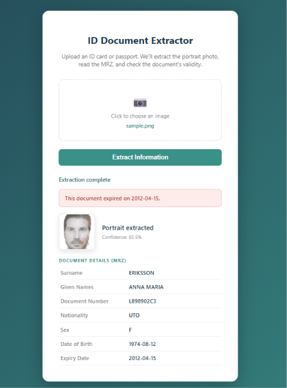

# Portrait & MRZ Extraction API

A FastAPI service that takes a photo or scan of a passport or ID card and returns:

- the **portrait photo**, cropped from the document
- the **MRZ data** (the machine-readable lines at the bottom of a passport), parsed into clean fields
- a **validity check**: whether the document is expired, expiring within 90 days, or valid

It includes a simple web interface for uploading documents and viewing the results.

Built during my AI Engineering internship at e& (Etisalat), June–August 2026.



*The sample is the official ICAO specimen passport (nationality "UTO" = Utopia). It contains no real personal data.*

## How It Works

```
Uploaded image
     │
     ├──► Face detection (OpenCV YuNet)
     │         │
     │         ▼
     │    Pick highest-confidence face → expand box with margin → crop portrait
     │
     └──► MRZ detection and OCR (PassportEye + Tesseract with an OCR-B model)
               │
               ▼
          Parse fields → clean names → format dates → check expiry
     │
     ▼
JSON response (portrait as base64, MRZ fields, expiry status)
```

### Improving MRZ accuracy

With Tesseract's default English model, the MRZ's `<` filler characters were often misread as letters, so a name like `ANNA<MARIA<<<<` came out as `ANNASMARIACSK`. Upscaling and binarising the image only helped partly. Switching to a Tesseract model trained specifically on the **OCR-B** font used in MRZs fixed it completely, so the specimen now reads exactly as printed.

## API

### `POST /extract`

Upload an image as `multipart/form-data` with the field name `file`.

```
curl -X POST -F "file=@sample.png" http://localhost:8000/extract
```

Example response (portrait shortened):

```json
{
  "success": true,
  "portrait_base64": "/9j/4AAQSkZJRg...",
  "portrait_confidence": 0.9352,
  "mrz_fields": {
    "surname": "ERIKSSON",
    "given_names": "ANNA MARIA",
    "nationality": "UTO",
    "sex": "F",
    "date_of_birth": "1974-08-12",
    "expiration_date": "2012-04-15",
    "document_number": "L898902C3",
    "document_type": "P<",
    "valid_score": 100
  },
  "expiry_status": {
    "is_expired": true,
    "message": "This document expired on 2012-04-15."
  }
}
```

| Status | Meaning |
|---|---|
| 200 | Portrait and/or MRZ extracted |
| 400 | The file is not a valid image |
| 422 | No face and no MRZ could be detected |

### `GET /`

The web interface for uploading a document and viewing the results.

Interactive API docs are available at `/docs` (generated automatically by FastAPI).

## Tech Stack

| Component | Technology |
|---|---|
| API | FastAPI, Uvicorn |
| Face detection | OpenCV YuNet (`face_detection_yunet.onnx`) |
| MRZ detection and parsing | PassportEye |
| OCR | Tesseract with an OCR-B trained model |
| Deployment | Docker, Railway |

## Project Structure

```
├── app.py                                  # FastAPI app: face detection, MRZ reading, expiry check
├── index.html                              # Web interface
├── face_detection_yunet.onnx               # Face detection model
├── tessdata/ocrb.traineddata               # Tesseract model for the MRZ font
├── sample.png                              # ICAO specimen passport for testing
├── screenshots/                            # Demo images
├── Dockerfile
├── requirements.txt
├── API_Documentation.pdf
└── Portrait_MRZ_API_Solution_Document.pdf  # Full solution write-up
```

## Running Locally

**Prerequisite:** [Tesseract OCR](https://github.com/tesseract-ocr/tesseract) (version 4 or newer) must be installed and on your PATH.

1. Clone the repo:
   ```
   git clone https://github.com/uzair852/portrait-mrz-extraction-api.git
   cd portrait-mrz-extraction-api
   ```
2. Install dependencies:
   ```
   pip install -r requirements.txt
   ```
3. Start the server:
   ```
   uvicorn app:app --reload
   ```
4. Open http://localhost:8000 and upload `sample.png`.

### With Docker

```
docker build -t mrz-api .
docker run -p 8000:8000 mrz-api
```

The Docker image installs Tesseract automatically.

## Credits

- OCR-B Tesseract model: [Shreeshrii/tessdata_ocrb](https://github.com/Shreeshrii/tessdata_ocrb)
- YuNet face detector: [OpenCV Zoo](https://github.com/opencv/opencv_zoo)